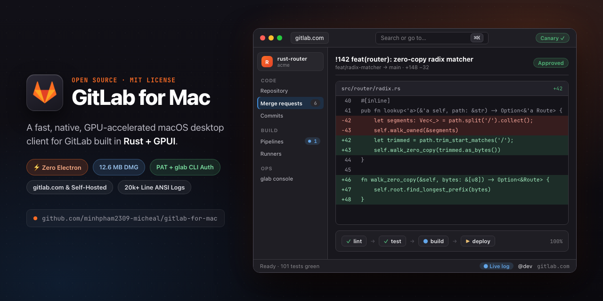
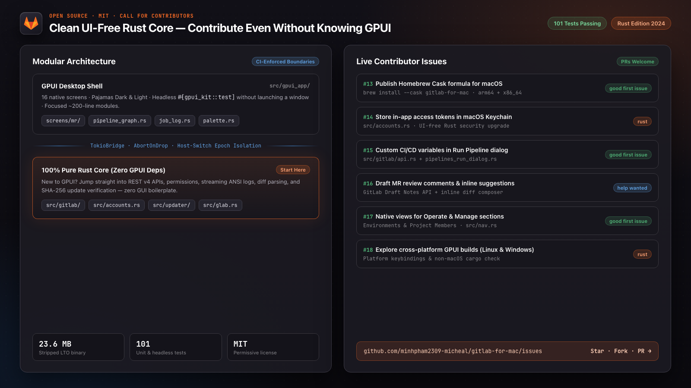

# GitLab for Mac

[](LICENSE)
[](Cargo.toml)
[](#installation--quick-start)
[](https://github.com/minhpham2309-micheal/gitlab-for-mac/releases/tag/canary)



A fast, native, GPU-accelerated macOS desktop client for GitLab built in Rust with **GPUI** (`gpui-kit`) — sign in directly with a Personal Access Token or reuse your existing [`glab`](https://gitlab.com/gitlab-org/cli) CLI sessions.

> **Status:** Active early development — bug reports, feature discussions, and pull requests are warmly welcome! Check open [`good first issue`](https://github.com/minhpham2309-micheal/gitlab-for-mac/labels/good%20first%20issue) and [`help wanted`](https://github.com/minhpham2309-micheal/gitlab-for-mac/labels/help%20wanted) issues to jump in.

---

## Why GitLab for Mac?

Working across multiple GitLab projects and self-hosted instances in a browser quickly turns into dozens of heavy tabs—especially when reviewing large merge request diffs, inspecting pipeline graphs, or tailing long CI/CD logs.

**GitLab for Mac** (`gitlab-for-mac`) gives you a keyboard-first native workspace with zero Electron overhead:

- **Native GPU rendering & tiny footprint** — built with Rust + GPUI (`~12.6 MB` Apple Silicon `.dmg`, `~23.6 MB` stripped LTO binary) and Pajamas-inspired Dark & Light themes.
- **Zero-friction authentication** — sign in directly with a GitLab Personal Access Token or auto-detect existing `glab` CLI hosts and tokens across `gitlab.com` and self-hosted instances.
- **Built for daily engineering ops** — virtualized MR diffs, zoomable CI/CD pipeline graphs, streaming 20k+ line ANSI job logs, repository browsing, issues, to-dos, and an embedded `glab` console in one window.

---

## Features

- **Multi-Host & Account Management:**
  - Sign in directly in-app with a Personal Access Token (with a 1-click *Create token* shortcut) or reuse authenticated `glab` CLI hosts.
  - Switch seamlessly between `gitlab.com` and self-hosted GitLab instances with full cache and request isolation on host switch.
- **Project Overview & Repository Explorer:**
  - Directory tree with last-commit metadata (with automatic fallback for older self-hosted GitLab instances).
  - Syntax-highlighted source viewer (`syntect`), Markdown/README rendering, binary and oversize file guards.
  - Fuzzy file finder (`⌘T`), branches, tags, and commit diff views.
- **Merge Requests & Code Review:**
  - Virtualized list and detail views with Open, Merged, Closed, and All filters.
  - Unified and Split diff views with inline discussions, reply/resolve actions, and native assignee & reviewer member picker.
  - Permission-gated UI controls (automatically hides or disables actions based on your GitLab role and archived state) plus confirmation-guarded Approve / Merge / Close / Rebase workflows.
- **CI/CD Pipelines & High-Throughput Job Logs:**
  - Stage and downstream bridge pipeline graph with floating `+/-` zoom controls, run, retry, cancel, manual job play, and artifact downloads.
  - Streaming ANSI log model (`src/gitlab/log_model.rs`) with collapsible GitLab log sections, live follow (`⌘L`), in-log search (`⌘F` / `⌘G`), and support for 20k+ lines without artificial truncation.
- **Issues, To-Do List & Operations:**
  - Native views for Issues, To-Do List, Releases, Pipeline Schedules, Runners, Code Search, and an integrated sandboxed `glab` CLI console.
- **In-App Self-Updater:**
  - Built-in `Stable` and `Canary` release channels (`src/updater/`) with SHA-256 checksum & codesign verification and 1-click install/update to `/Applications`.
- **Keyboard-First Navigation:**
  - Command palette (`⌘K`), back/forward navigation history (`⌘[` / `⌘]`), collapsible super-sidebar (`⌘\`), live UI zoom (`⌘=` / `⌘-` / `⌘0`), Dark/Light theme toggle (`⌘⇧T`), and typography/layout preferences (`⌘,`).

---

## Security & Isolation Model

Because a GitLab client handles personal access tokens and untrusted repository/issue content, security boundaries are enforced in core modules:

- **Origin-bound credentials** (`src/gitlab/http_util.rs`, `src/config.rs`, `src/accounts.rs`): Access tokens are only attached to the configured GitLab origin over HTTPS (or loopback HTTP for local testing), never re-attached across cross-origin redirects, redacted in `Debug` output, and stored with `0700`/`0600` file permissions when saved in-app.
- **SSRF & media guards** (`src/gitlab/media.rs`, `src/gpui_app/markdown.rs`, `src/gpui_app/safe_url.rs`): Blocks loopback, private-network, IPv4-mapped, and local domains for remote images; validates URL schemes (`http`/`https` only) before opening links in the browser.
- **Console guardrails** (`src/gpui_app/screens/ops/console_args.rs`, `src/glab.rs`): Flags sensitive `glab` subcommands (`auth`, `config`, `alias`), redacts GitLab token prefixes, and bounds command execution with a 30-second timeout and 4 MB output cap.
- **Host-switch isolation** (`src/gpui_app/state.rs`, `src/runtime.rs`): Switching hosts increments generation epochs, cancels in-flight Tokio tasks via `AbortOnDrop`, and clears `ImageCache` and `RepoCache`.
- **Verified updates & CI gates** (`src/updater/`, `.github/workflows/`): In-app updates verify SHA-256 manifests and macOS code signatures prior to replacement; CI runs `cargo-deny`, `gitleaks`, and architecture boundary audits on every PR and release.

---

## Installation & Quick Start

### Option 1: Download Prebuilt macOS Canary (Apple Silicon)

Download the latest automated `main` build (`GitLab-for-Mac-canary-arm64.dmg` or `.app.zip`) from [**GitHub Releases (Canary)**](https://github.com/minhpham2309-micheal/gitlab-for-mac/releases/tag/canary), drag **GitLab for Mac.app** into `/Applications`, and launch.

> **macOS Gatekeeper note:** Rolling Canary builds are currently ad-hoc signed (Apple Developer notarization is not yet enabled). On first launch, macOS may warn that the app cannot be verified. You can allow it via **System Settings → Privacy & Security → Open Anyway**, or run:
> ```bash
> xattr -cr "/Applications/GitLab for Mac.app"
> ```

### Option 2: Build from Source (Apple Silicon or Intel)

#### Prerequisites

- **macOS 13.0+** (Apple Silicon or Intel)
- **Rust toolchain** (1.88+, Edition 2024 — install via [rustup](https://rustup.rs))
- **[`glab` CLI](https://gitlab.com/gitlab-org/cli)** *(optional — needed only if you want auto-detected `glab` sessions or the embedded `glab` console)*

```bash
git clone https://github.com/minhpham2309-micheal/gitlab-for-mac.git
cd gitlab-for-mac

# Development run
cargo run

# Optimized release build (LTO + stripped binary)
cargo build --release
./target/release/gitlab-for-mac
```

### Signing In

You can authenticate using either option:

1. **In-app Personal Access Token:** Launch the app, enter your GitLab host (`gitlab.com` or self-hosted), and paste a Personal Access Token with scopes `api`, `read_user`, `read_repository` (saved locally at `~/Library/Application Support/gitlab-for-mac/accounts.json` with mode `0600`).
2. **Existing `glab` CLI session:** Run `glab auth login` once — GitLab for Mac automatically detects `~/Library/Application Support/glab-cli/config.yml` or `~/.config/glab-cli/config.yml`.

Local UI preferences are stored separately at `~/Library/Application Support/gitlab-for-mac/prefs.json`.

---

## Keyboard Shortcuts

Keybindings are registered in [`src/gpui_app/actions.rs`](src/gpui_app/actions.rs):

| Shortcut | Action |
|---|---|
| `⌘K` | Open / toggle Command Palette |
| `⌘T` | Fuzzy Find File in repository |
| `⌘P` | Jump to Projects switcher |
| `⌘[` / `⌘]` | Navigate Back / Forward |
| `⌘\` | Collapse / Expand sidebar |
| `⌘⇧T` | Toggle Dark / Light Pajamas theme |
| `⌘R` | Refresh active screen |
| `⌘,` | Open Preferences |
| `⌘=` / `⌘-` / `⌘0` | Zoom In / Zoom Out / Reset UI scale |
| `⌘L` | Toggle live-follow in Job Log |
| `⌘F` / `⌘G` / `⌘⇧G` | Search in Job Log / Next / Previous match |
| `⌘⇧C` | Copy full Job Log |
| `Esc` | Dismiss active overlay / modal |

---

## Architecture & Project Structure

The codebase enforces a clean separation between **pure GitLab/domain/updater logic** (zero UI dependency) and the **GPUI desktop layer**:

```text
┌──────────────────────────────────────────────────────────────────────┐
│                     GPUI Desktop Shell (src/gpui_app/)               │
│   AppShell · TopBar · Super Sidebar · Command Palette · Screens      │
│   AppState (epochs, nav history, prefs) · ImageCache · RepoCache     │
└───────────────────────────────┬──────────────────────────────────────┘
                                │ TokioBridge (AbortOnDrop)
                                ▼
┌───────────────────────────────┴──────────────────────────────────────┐
│                       Core & Data Layer (UI-free)                    │
│  src/gitlab/    REST v4 client · permissions · diff & ANSI log model │
│  src/accounts*  in-app account store · glab YAML discovery & merge   │
│  src/updater/   GitHub release checks · SHA-256 & codesign verify    │
│  src/glab.rs    sandboxed glab CLI subprocess runner                 │
│  src/nav.rs     screen/section model  ·  src/prefs.rs  persistence   │
└──────────────────────────────────────────────────────────────────────┘
```

### Directory Overview

| Path | Responsibility |
|---|---|
| `src/main.rs`, `src/lib.rs` | Binary entry point (`gitlab_for_mac::gpui_app::run`) and library exports |
| `src/accounts.rs`, `src/config*.rs` | In-app PAT account storage (`0600`), `glab-cli/config.yml` discovery, and host/origin validation |
| `src/gitlab/` | UI-free async GitLab REST v4 client (`reqwest` + `rustls`), permission model, redirect & media guards, unified diff parser, ANSI/collapsible job log engine |
| `src/updater/` | UI-free release checker (Stable & Canary), SHA-256/codesign verifier, and atomic `.app` bundle updater |
| `src/glab.rs` | Bounded async `glab` subprocess execution (30s timeout, 4 MB cap) |
| `src/runtime.rs` | Multi-threaded Tokio runtime bridge with automatic task cancellation on drop |
| `src/nav.rs`, `src/prefs.rs` | Navigation taxonomy (16 screens, 9 sidebar sections) and clamped UI preferences |
| `src/gpui_app/` | GPUI shell, Pajamas theme, sidebar, topbar, statusbar, command palette, update modal, caches, safe markdown/URL helpers |
| `src/gpui_app/screens/` | Feature screens: `login`, `overview/`, `repository/`, `code_refs/`, `mr/`, `ops/`, pipelines & job logs, issues, to-dos, projects, and preferences |
| `assets/`, `fonts/` | Bundled `.icns` app icon, SVG icons, and JetBrains Mono font files |
| `tests/` | Headless GPUI UI, permissions, MR, pipeline zoom, repo, and updater integration tests |

### Engineering Conventions

- **Keep `src/gitlab/` and `src/updater/` UI-agnostic:** Data fetching, permission logic, diff/log parsing, and update verification stay independent of `gpui-kit` (enforced in CI by `.github/scripts/check-rust-boundaries.py`) — making them fast to test and welcoming for Rust contributors who don't know GPUI yet.
- **Small, focused modules:** Target under ~200 lines per file (250-line hard cap enforced in CI).
- **Stale-response protection:** Async UI loads check `host_epoch` / `project_epoch` before committing results to state.
- **Headless UI testing:** UI regressions are verified automatically with `#[gpui_kit::test]` without launching a visible desktop window.

---

## Development & Testing

```bash
# Run all unit tests and headless GPUI integration tests
cargo test --locked

# Run linter with CI-equivalent strictness
cargo clippy --locked --lib --bins -- -D warnings
cargo clippy --locked --all-targets -- -D warnings

# Run architecture & repository hygiene audit
.github/scripts/check-repo-hygiene.sh

# Build optimized release binary
cargo build --release
```

---

## Contributing



Contributions of all sizes are welcome—whether it's a bug fix, pure-Rust GitLab API improvement, GPUI screen, distribution helper, or documentation polish.

**New to GPUI?** No problem—`src/gitlab/`, `src/accounts.rs`, and `src/updater/` are 100% pure Rust with zero UI dependencies. Browse open [`good first issue`](https://github.com/minhpham2309-micheal/gitlab-for-mac/labels/good%20first%20issue) and [`help wanted`](https://github.com/minhpham2309-micheal/gitlab-for-mac/labels/help%20wanted) issues to find a scoped task.

### Great Areas to Contribute

- **Distribution & Packaging:** Homebrew Cask formula (`brew install --cask gitlab-for-mac`) and release automation refinements.
- **Security & Auth:** Migrating saved in-app Personal Access Tokens from `accounts.json` (`0600`) to macOS Keychain.
- **CI/CD Workflow:** Custom CI/CD key-value variables in the Run Pipeline dialog and trigger previews.
- **Code Review Enhancements:** Draft review comments (batch submit), inline code suggestions, and commit-by-commit MR diff filtering.
- **Expanding Native Sidebar Sections:** Sections currently opening in GitLab Web (`Manage`, `Secure`, `Operate`, `Monitor`, `Analyze` in `src/nav.rs`) are natural candidates for native views.
- **UI Polish, Accessibility & Cross-Platform:** Keyboard navigation across lists/diffs, screen-reader labels, and exploring Linux/Windows GPUI builds.

### Pull Request Workflow

1. **Discuss larger changes first:** Open or comment on an Issue before starting major features or architectural shifts.
2. **Fork & branch from `main`:** Create a focused branch (`feat/<slug>`, `fix/<slug>`, `docs/<slug>`, `chore/<slug>`).
3. **Keep tests, lint, and hygiene green:**
   ```bash
   cargo clippy --locked --all-targets -- -D warnings
   cargo test --locked
   .github/scripts/check-repo-hygiene.sh
   ```
4. **Keep fixtures clean:** Never commit real tokens, `.env*` files, local paths, or internal hostnames—use synthetic `*.example.com` / `*.test` values in tests.
5. **Use Conventional Commits:** `feat:`, `fix:`, `refactor:`, `docs:`, `test:`, `chore:` (for single-commit PRs, match the PR title to the commit message).

---

## License

Licensed under the [MIT License](LICENSE).
